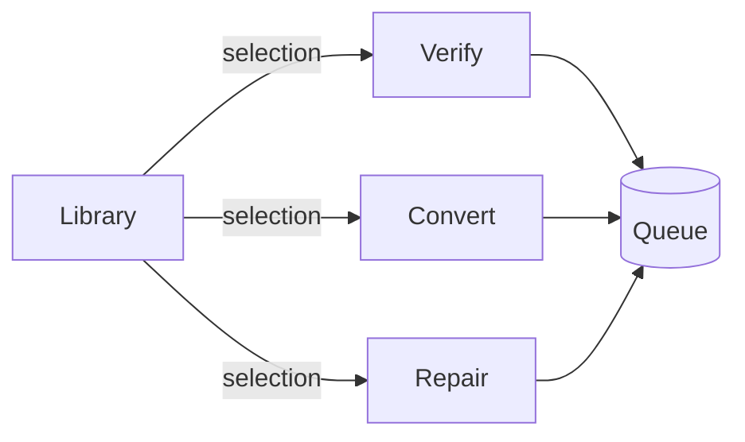
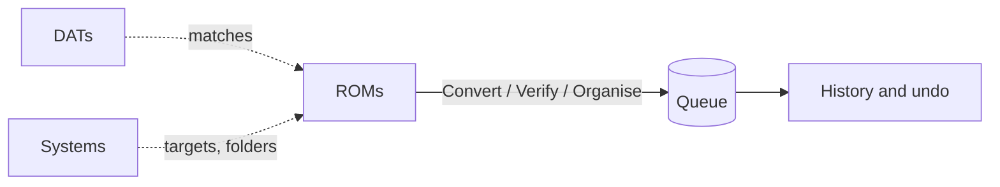
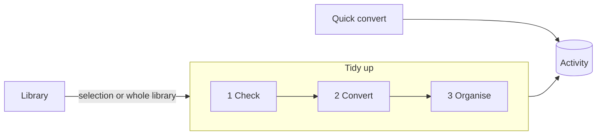

# Information architecture

The structure of NoIntrovert's window: what the top-level places are, what lives in each, and what they're
called. This file is the source of truth for the IA. Change it in the same PR as any change to the rail,
a page, or a top-level label, and keep [Current structure](#current-structure) matching what ships.

Sections:

1. [Current structure](#current-structure) (the UI redesign, Nov 2026)
2. [What the structure has to serve](#what-the-structure-has-to-serve)
3. [Option A: task-first](#option-a-task-first)
4. [Option B: object-first](#option-b-object-first)
5. [Option C: library hub with one pipeline](#option-c-library-hub-with-one-pipeline)
6. [Comparison](#comparison)
7. [Recommendation](#recommendation)
8. [The case against C](#the-case-against-c)
9. [How to decide](#how-to-decide)

A shareable version of section 1 with diagrams and screenshots is in Google Docs
(*NoIntrovert: current information architecture*).

---

## Current structure

One window. A navigation rail on the left: the NoIntrovert logo at the top, then two labelled sections,
**Library** and **Files**, and Settings at the bottom below a divider. Under every page, a log collapsed to
one bar (error and warning counts, Show log), a queue drawer (hidden until opened; it keeps the 20 newest
finished batches, plus any with a failure, until Clear finished) and a status bar with overall queue progress. The redesign is specified in [ui-redesign](requirements/ui-redesign.md).

- **Library**
  - **Optimize** (was Library; start page once a library folder exists), with "Verify, Rename, Convert,
    Organize" under its rail button
    - Toolbar: Add folder… · Rescan · folder chips
    - Filters: search · system · status · summary line
    - Game list: Game · System · Formats · Size · Status
    - Selection actions: Clean up selected · Verify selected · **Convert selected**
    - Side panel: Selected file (as on Convert, for the selected game) · Details (status, match) · Files (each file, its planned conversion, Show)
- **Files**
  - **Convert** (start page with no library folders)
    - Toolbar: Add files… · Add folder… · Add folder as one archive… · Remove · Clear finished · Clear all · filter
    - A banner above the list when the CHD converter (chdkit) is missing or blocked: reinstall, or check the antivirus quarantine
    - Rows: File · Type · **Preset** (per row) · Size · Status · Progress · Time · Result
    - Side panel, for the focused row: File (system, facts, formats) · Preset (with Works with) · Preset
      settings (Custom only) · Wii U, 3DS or Switch keys (for selected files that need them)
    - A row that failed for missing keys: Set up keys → Settings, scrolled to Keys
    - Run bar: **Save to** (Next to the originals · Folder: <path> · Change… · Layout: ES-DE, RomM, Same folders or No subfolders ·
      Replace the originals ⚠) ·
      Cancel · Convert
  - **Verify** (was Verify & match)
    - Job list (as Convert, no Preset column, no Save to)
    - Side panel: Selected file (as on Convert) · game databases (status, Update now) · *Checking games* preset
  - **Organize** (was Cleanup)
    - Plan: scope (selected games or whole Library) · steps with tick boxes (Step · Game · Change) · a box per kind
      of step, with its count
    - Actions: Whole Library · Make the plan again · Verify the unchecked ones · **Run**
    - Side panel: Selected file (the picked step's, as on Convert) · file layout (ES-DE or keep) · safety note · past runs (Undo, Empty trash)
  - **Library tests** (Power-user mode only): round trip and chdman comparison, results table, CSV export
- **Settings** (one page of cards, saved as they change): General (theme, Start on) · Output (Save to's
  default, Folder layout, Overwrite existing files, working folder) · Performance · Log · Default presets · Library (folders,
  emulator data with Check now) · About. Under **Advanced**: Power user · How each action is done ·
  Default targets · Files and folders · Keys · Game databases (and ES-DE systems) · Target formats (by
  system, by file type, rule options) · Expert · Diagnostics (Power-user)

The CHD info page is gone. Originals are removed only by Save to › Replace the originals, never by a preset.

Hand-offs: Optimize → Convert, Verify or Organize (with the selection); Organize → Verify (unmatched files);
Convert, Verify and Library tests → Settings. A drop goes to the page you're on (on Optimize, folders become
library folders and loose files go to Convert).

Known friction, from the review of the structure before the redesign (main at d6b2192):

- The same control lives in several places: Cleanup layout (Cleanup and Settings), Wii U keys (Convert and
  Settings), game databases (Verify and Settings), presets (Convert, Verify and Settings).
- Library and Convert overlap: both list things and both start conversions, one by game, one by file.
- Cleanup renames and moves only games Verify has matched, so a first cleanup sends you to Verify and back,
  and nothing says so up front.
- CHD info and Library tests are utilities sitting in the main rail next to the workflow.
- Labels pull in different directions: *Cleanup* (page) vs *Clean up selected* (button), *Verify & match*
  (page) vs *Checking games* (preset), *Library* vs *Library tests*.

---

## What the structure has to serve

Who uses it, and for what, decides which structure wins. Four jobs, roughly in order of how often they come up:

| # | Job | Scale | Today |
|---|---|---|---|
| J1 | "Make my collection right": convert, rename, sort into ES-DE folders, drop duplicates | hundreds to 5,000 games | Library → Verify → Library → Cleanup |
| J2 | "Convert these few files" someone dropped on the window | 1–20 files | Convert |
| J3 | "Is this dump good, and what is it?" | one game or a folder | Verify & match |
| J4 | "Look inside this CHD" / "test lib-chd-kit" | one file | CHD info / Library tests |

Constraints any structure must keep:

- **Nothing changes on disk without a preview.** Cleanup's dry run and the Convert rows' targets are that
  preview; neither can disappear.
- **One queue.** Every action feeds the same queue, and its progress has to be visible from anywhere.
- **Progressive disclosure.** Presets first, parameters under Custom, expert options in Power-user mode
  ([presets](requirements/presets.md)).
- **5,000 games.** Lists stay virtualised and filterable; no structure may require walking games one by one.

---

## Option A: task-first

Top level is what you want to do. Each page is a verb, and the Library is where you pick what to do it to.

- **Library**: your games, statuses, details (as today, minus nothing)
- **Verify**: check for damage and identify against No-Intro and Redump (today's Verify & match)
- **Convert**: change formats, per-row targets and presets (today's Convert)
- **Repair**: fix what Verify found: rename to database names, sort into the layout, remove duplicates, fix a
  CHD's header SHA-1 (today's Cleanup, plus the header fix moved out of the Verify preset)
- **Tools**: CHD info, Library tests (Power-user)
- **Settings**

**Labels.** Verbs, because the user arrives with an intent ("I want to check these"). *Verify* drops
*& match*: matching is what verifying against a database means, and the shorter word fits the rail.
*Repair* replaces *Cleanup* because the page's job is to fix things Verify flagged, and it pairs with the
verb before it; *Cleanup* reads as "delete stuff", which is the part users fear. *Tools* collects the two
single-file utilities so the rail is only workflow.

**Gains.**
- Each page answers one question, so the rail reads as a menu of intents. J2 and J3 are one click.
- The Verify → Repair order is visible in the rail itself; the dependency stops being a surprise.
- Moves CHD info and Library tests out of the main list.

**Costs.**
- J1 still crosses three pages. The rail suggests an order but nothing carries you along it.
- *Repair* overpromises: it can't fix a damaged dump, only names, places and duplicates. A user with a bad
  disc goes there and finds nothing for it.
- Conversion also happens inside Repair (Cleanup converts as part of its plan), so "where do I convert?"
  has two answers, as it does today.

---

## Option B: object-first

Top level is the things the app manages. Actions are verbs on whatever you've selected, available wherever
that object appears.

- **ROMs** (or **Games**): the library, every file grouped into games. Selection actions: Convert, Verify,
  Organise. Loose files dropped on the window appear here as an "Unsorted" source, not a separate page.
- **DATs** (or **Databases**): which No-Intro and Redump databases are installed, their dates, your own DATs,
  the match results per system.
- **Systems**: one row per system: target format and container, ES-DE folder name, multi-disc folder,
  how many games and how many still need converting. Today's *Target formats* rules editor and default
  targets live here.
- **Queue**: running and finished jobs, the log, and past runs with Undo and Empty trash.
- **Settings**: presets, output, performance, keys, general.

**Labels.** Nouns, so each page is a place you can look things up. *Systems* earns a top-level spot because
three settings that today live in different cards (target formats, ES-DE names, default targets) are all
facts about a system. *Queue* absorbs Cleanup's past runs because undo is history, and history belongs with
the jobs that made it. *ROMs* is the community word, but it's wrong for disc images and Wii U titles;
*Games* is the safer label, and the doc uses *Games* below.

**Gains.**
- No duplicated controls: each setting has one home, next to the object it describes.
- Scales well for J1 on big collections: filter Games to "needs converting" or "not matched", select all,
  act. No hand-off between pages.
- *Systems* makes the rules visible. Today they're behind Settings ▸ Target formats ▸ Advanced.

**Costs.**
- J2 (a few dropped files) has no natural home. Putting them in Games as "Unsorted" mixes throwaway files
  into the collection view.
- Verbs are hidden in selection menus. A new user asked "how do I verify?" has nothing in the rail to click.
- *DATs* is jargon. Most people who want "is this a good dump?" don't know the word, and the page is mostly
  status that changes once a month.
- The Cleanup preview becomes a dialog or a mode of the Games page, which is hard to do well at 5,000 rows.

---

## Option C: library hub with one pipeline

The Library is the home page. Working on the collection is one guided page with three stages in a fixed
order. Quick jobs on loose files keep their own page.

- **Library**: games, statuses, details; one primary action, **Tidy up selected** (or the whole library)
- **Tidy up**: one plan for the selection, in stages you can see and skip:
  1. **Check**: verify and match what hasn't been checked (today's Verify, run as part of the plan)
  2. **Convert**: the conversions the target formats call for, with this stage's presets
  3. **Organise**: renames, ES-DE layout, duplicates (today's Cleanup steps)
  - Each stage shows its steps with tick boxes before anything runs; **Run** runs the ticked stages in order.
- **Quick convert**: drop files, pick targets, convert. Today's Convert page, for files outside the library.
- **Activity**: the queue, the log, and past runs with Undo
- **Tools**: CHD info, Verify a file (one-off check outside the library), Library tests (Power-user)
- **Settings**

**Labels.** *Tidy up* names the outcome the user wants for J1 and is the plain-language version of what
Cleanup does today. Stage names are short verbs (*Check*, *Convert*, *Organise*) so the order reads as a
sentence. *Check* replaces *Verify & match* inside the pipeline because the stage both checks for damage
and identifies; *Verify* is kept as the tool name for a one-off file, where users expect the technical word.
*Quick convert* tells people this page is for a handful of files, not the collection. *Activity* covers
the queue, the log and history in a word that doesn't promise only "jobs waiting".

**Gains.**
- J1 becomes one place and one Run, in the right order, with the Verify dependency built in instead of a
  detour.
- The Library vs Convert overlap goes away: the library converts through Tidy up, loose files through Quick
  convert.
- One preview for everything that touches the collection, which keeps the "nothing without a preview" rule
  in one place.
- Utilities leave the main rail.

**Costs.**
- A real build: merging Verify into a plan stage and making Cleanup's planner cover conversion it currently
  does only for matched games.
- Two conversion pages (Tidy up and Quick convert) that must share presets and target rules exactly, or
  users will see different results for the same file.
- Users who only want to verify their collection now go through a page called *Tidy up*.

---

## Comparison

Scores are judgement, 1 (poor) to 3 (good), against the jobs and constraints above.

| | Current | A: task-first | B: object-first | C: hub and pipeline |
|---|---|---|---|---|
| J1 collection, 5,000 games | 1 | 2 | 3 | 3 |
| J2 a few loose files | 3 | 3 | 1 | 3 |
| J3 is this dump good | 3 | 3 | 2 | 2 |
| J4 utilities out of the way | 1 | 3 | 3 | 3 |
| One home per setting | 1 | 1 | 3 | 2 |
| Labels a newcomer understands | 2 | 2 | 1 | 3 |
| Preview before changes | 3 | 3 | 2 | 3 |
| Cost to build from today | — | low | high | medium–high |

---

## Recommendation

**Option C**, built in steps so each step ships on its own:

1. Move CHD info and Library tests into **Tools**; rename *Cleanup* to *Tidy up*. Cheap, and fixes two
   friction points.
2. Make Tidy up's plan include unchecked games as a **Check** stage that runs Verify first.
3. Add the **Convert** stage, so the library no longer hands files to the Convert page; rename that page
   *Quick convert*.
4. Fold the queue drawer, log and past runs into **Activity**.

Take two things from B: a **Systems** view inside Settings (target formats, ES-DE names and default targets
together), and one home per setting, with the other pages linking there instead of repeating the control.

---

## The case against C

Arguing the other side, as hard as the evidence allows.

- **The pipeline is the old wizard problem.** Tidy up hides three different jobs behind one button. People
  who want only one of them (rename without converting, or convert without the ES-DE move) have to find the
  stage tick boxes and untick two of them every time. Option A gives each job its own page and never makes
  you opt out.
- **The order is wrong for some users.** Check before Convert assumes database names matter. Someone with
  homebrew, translations or hacks gets nothing from Check (no DAT has their files), and every run of Tidy up
  spends time hashing games that will never match.
- **It hides the slow step.** Check hashes every unchecked game. On a first run over 5,000 games that's hours,
  and in C it runs inside "tidy up", where nobody expects it. Today's separate Verify page makes the cost a
  choice.
- **Two conversion pages will drift.** Quick convert and the Convert stage share rules in code, but they'll
  get different UI over time: a fix lands in one, a preset label changes in the other. The current single
  Convert page can't drift from itself.
- **"Tidy up" is soft.** It tells a newcomer nothing about formats or databases, and an experienced user
  looking for "verify" or "convert" in the rail won't find either word at the top level. A's verbs are
  plainer.
- **B was scored down for work it would save later.** B's one-home-per-setting is the only option that
  removes the duplication instead of moving it, and C keeps presets reachable from Tidy up, Quick convert
  and Settings. The *Systems* view borrowed from B may end up the real centre of the app.
- **The cost estimate is optimistic.** Step 3 means Cleanup's planner learning conversions it does today
  only for matched games, plus progress reporting across stages. That is the hardest code in the app.

What would change the recommendation:

- If most users never add a library folder (they drop files and leave), the Library hub serves few people,
  and **A** is the better shape.
- If users mostly work one system at a time, **B**'s Systems page becomes the natural home page.

---

## How to decide

Before building past step 1:

1. **Tree test** each option's labels with 5–8 people who keep ROM collections: "Where would you go to make
   your PS1 games into CHDs?", "...find out if a dump is good?", "...undo yesterday's changes?". Success
   rate and first click per option.
2. **Count the jobs.** Add an opt-in, local-only counter for which page starts each run (Convert,
   Verify, Cleanup) over a few weeks of real use. If loose-file conversions dominate, revisit the hub.
3. **Time a first Check** over a large library (the 5,000-game scale test) to see whether hashing inside
   the pipeline is acceptable or needs to stay a separate, explicit step.

Record the outcome here, update [Current structure](#current-structure) when a step ships, and keep the
options above as the history of why.

**Outcome so far (UI redesign, Nov 2026).** The rail took a mix of A and C: a **Library** section with one
page, **Optimize**, named for the whole-collection job, and a **Files** section of verbs (Convert, Verify,
Organize). CHD info was removed rather than moved to Tools, and Library tests stays in the rail only in
Power-user mode. *Organize* was chosen over *Repair* and *Tidy up*; *Verify* dropped *& match*. Where files
go moved out of the side panel into the run bar's Save to, which is also the only control that removes
originals. The pipeline (C's steps 2–4) is not built.
